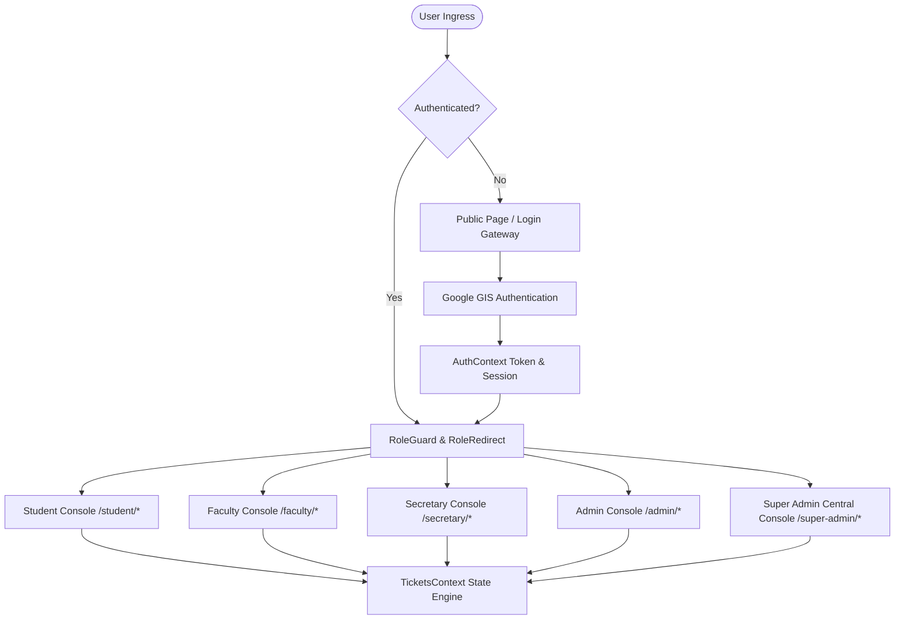

# 01 • System Architecture

## 1. Overview & Purpose
**MSIS Support** is a mission-critical web application designed for the **Medical Student Information System (MSIS)** of **Southwestern University PHINMA • School of Medicine**. It provides centralized, role-attributed defect reporting, system diagnostic capture, real-time ticket triage, and operational transparency across all institutional stakeholders.

---

## 2. Technology Stack

| Layer | Technology | Version | Purpose |
| :--- | :--- | :--- | :--- |
| **Framework** | [React](https://react.dev/) | `^19.3.1` | Concurrent UI rendering and modern component primitives |
| **Language** | [TypeScript](https://www.typescriptlang.org/) | `~7.0.2` | Static type safety and data model guarantees |
| **Build Tooling** | [Vite](https://vite.dev/) | `^8.3.5` | Instant HMR, ESM bundling, and optimized production rollups |
| **Styling** | [Tailwind CSS](https://tailwindcss.com/) | `^4.3.4` | Modern CSS-in-JS utility-first design system with `@tailwindcss/vite` |
| **Animation** | [Framer Motion](https://www.framer.com/motion/) | `^14.9.1` | Declarative page and modal transition animations |
| **Icons** | [Lucide React](https://lucide.dev/) | `^1.68.0` | Accessible, consistent SVG iconography |
| **Routing** | [React Router](https://reactrouter.com/) | `^7.18.5` | Declarative client-side routing, guards, and redirection |
| **Authentication** | Google Identity Services (GIS) | Native SDK | Institutional Single Sign-On (SSO) with One Tap & popup flow |

---

## 3. High-Level Architectural Flow

---

## 4. Key Architectural Pillars

1. **Strict Institutional Boundary:** Authentication restricts access to `@swu.phinmaed.com` institutional domains and authorized administrators.
2. **Context-Driven State Isolation:** UI state, auth telemetry, and ticket stores are managed via decoupled React Context providers (`AuthContext`, `TicketsContext`) without heavyweight external state machinery.
3. **Role-Attributed Workspaces:** Dedicated role routes isolate user permissions, submissions, and telemetry queues while giving Super Admins unified cross-domain oversight.
4. **Adaptive Multi-Form Layout:** Responsive desktop layout features a permanent fixed sidebar; mobile form factors seamlessly switch to an ergonomic curved bottom navigation bar.
