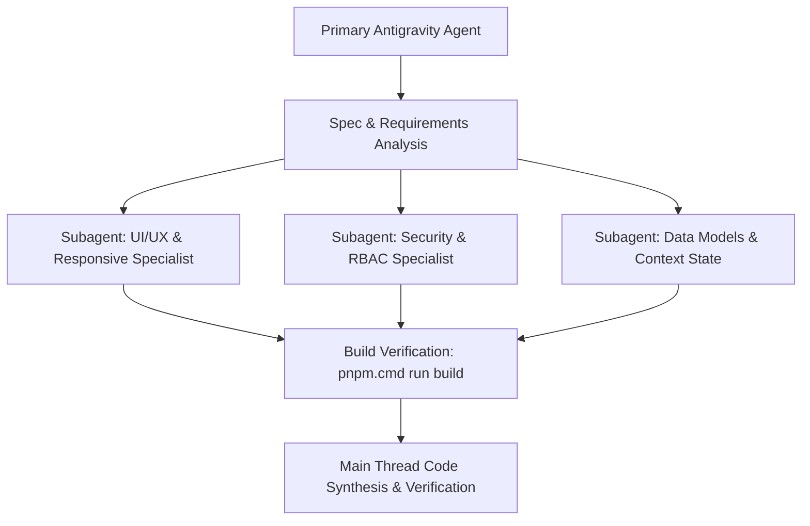

# 02 • Subagent Workflows & Task Delegation

## 1. Subagent Architecture
When working on large refactors or complex cross-cutting tasks across SupportMSIS, autonomous subagents can be dispatched to operate in parallel.

---

## 2. Delegation Matrix

| Subagent Role | Primary Scope | Typical Responsibilities |
| :--- | :--- | :--- |
| **Codebase Researcher** | Read-only survey | Inspecting cross-role route dependencies, tracing context consumers, analyzing bundle size. |
| **UI/UX Specialist** | Component authoring | Responsive mobile behavior, modal alignment, pagination controls, touch-friendly navigation. |
| **Security & Auth Auditor** | RBAC & Session rules | Auditing `RoleGuard.tsx`, Google OAuth GIS tokens, and permission elevation loopholes. |
| **Documentation Maintainer** | Technical authoring | Updating numerical docs in `docs/00` through `docs/zz`, maintaining directory indices. |

---

## 3. Communication Rules Between Agents
- Never send subagent messages to the end user; use direct agent responses for user communication.
- Return structured status summaries when a subagent task completes, including files modified, diff summary, and build status.
