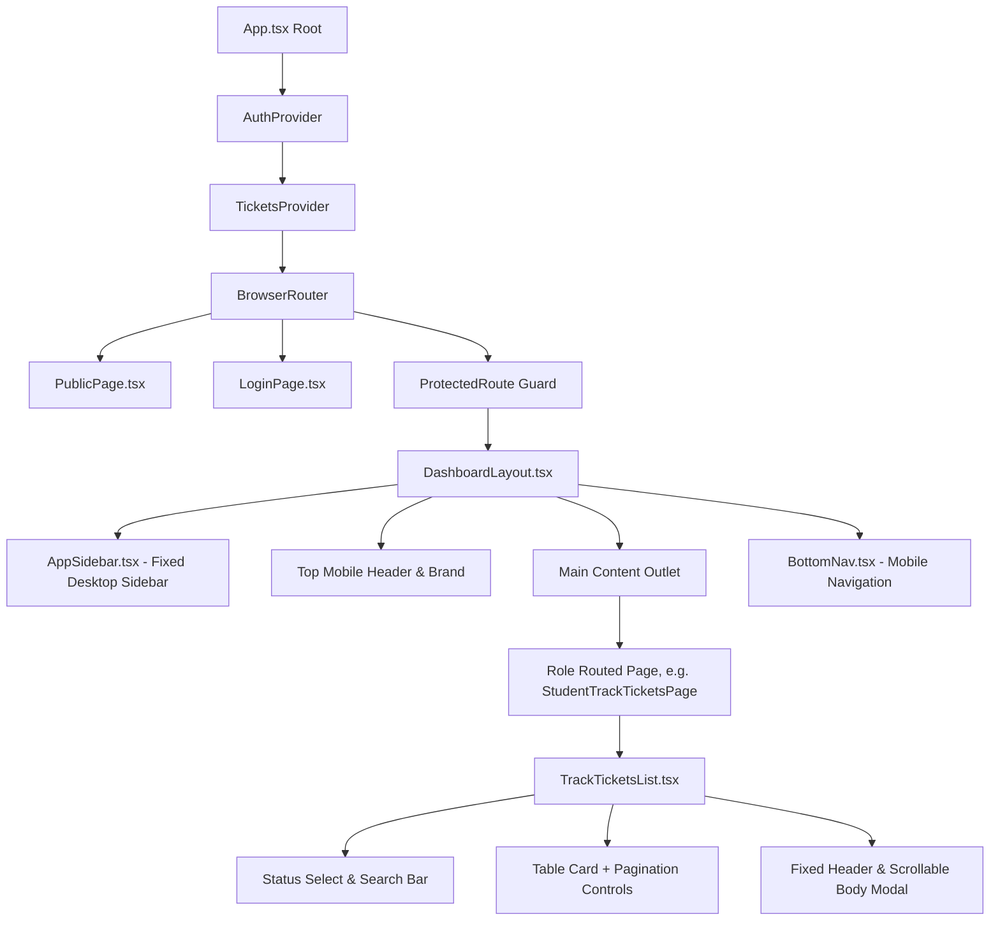

# 02 • Component Hierarchy & Composition

## 1. Composition Architecture

SupportMSIS follows an explicit composition hierarchy to guarantee layout stability:

---

## 2. Layout Wrapper Rules

- **Desktop (`>= md`):**
  - Desktop sidebar is rendered as `fixed top-0 bottom-0 left-0 z-30 h-screen`.
  - Main container reserves a placeholder offset (`w-64` or `w-[72px]` when collapsed) so that scrolling the page content never shifts or un-pins the navigation sidebar.
- **Mobile (`< md`):**
  - Desktop sidebar is hidden (`hidden md:flex`).
  - Mobile bottom nav is fixed (`fixed bottom-0 left-0 right-0 z-40`).
  - Main view container applies bottom padding (`pb-24`) so bottom navigation buttons never obscure table pagination controls or action buttons.
