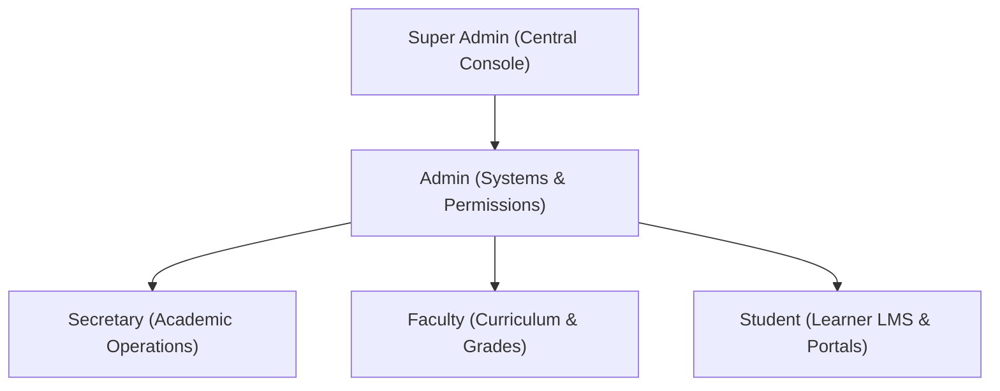

# 01 • Role Hierarchy & Access Matrix

## 1. Role Definitions

SupportMSIS establishes 5 discrete user roles tailored to medical university operations:

---

## 2. Capabilities Matrix

| Feature | Student | Faculty | Secretary | Admin | Super Admin |
| :--- | :---: | :---: | :---: | :---: | :---: |
| **Public Information Portal** | ✅ | ✅ | ✅ | ✅ | ✅ |
| **Google SSO Sign-In** | ✅ | ✅ | ✅ | ✅ | ✅ |
| **Submit Role-Attributed Ticket** | ✅ | ✅ | ✅ | ✅ | ✅ |
| **Multi-File Diagnostic Uploads** | ✅ | ✅ | ✅ | ✅ | ✅ |
| **Track Role Tickets & Status** | ✅ | ✅ | ✅ | ✅ | ✅ |
| **Interactive Status Dropdown** | ✅ | ✅ | ✅ | ✅ | ✅ |
| **View Technical Diagnostic Response** | ✅ | ✅ | ✅ | ✅ | ✅ |
| **Manage Infrastructure Tickets** | ❌ | ❌ | ❌ | ✅ | ✅ |
| **Cross-Role Central Ticket Inspection** | ❌ | ❌ | ❌ | ❌ | ✅ |
| **Cross-Role Metric Oversight** | ❌ | ❌ | ❌ | ❌ | ✅ |
| **Global Role Switching Tool** | ❌ | ❌ | ❌ | ❌ | ✅ |
