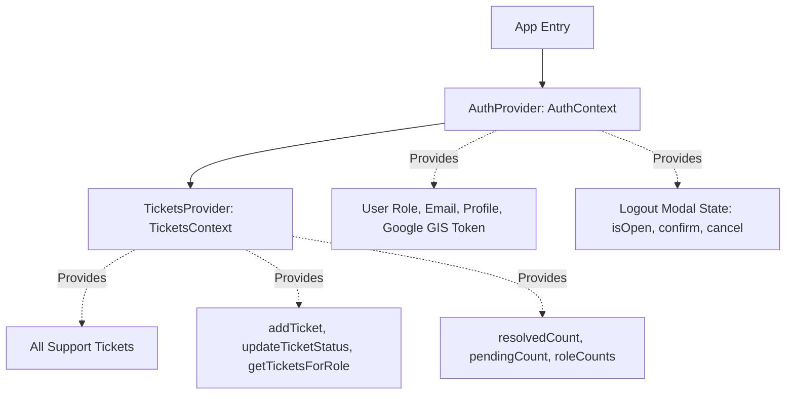

# 01 • State Management & Context Engines

## 1. Context Architecture

SupportMSIS utilizes two primary React Context engines to manage data and session persistence across role routes:

---

## 2. Context Responsibilities

### A. `AuthContext.tsx`
- **Session Hydration:** Loads stored authentication tokens and user telemetry from `localStorage` on initial mount.
- **Google GIS SSO:** Wraps Google Identity Services One Tap and credential callback responses.
- **Global Sign-Out Modal:** Controls the application-wide sign-out confirmation dialog (`LogoutConfirmModal.tsx`), supporting keyboard accessibility (`Escape` key cancellation).

### B. `TicketsContext.tsx`
- **Ticket Store:** Holds seed data for Student, Faculty, Secretary, and Admin tickets.
- **Status Updates:** Exposes `updateTicketStatus(ticketId, newStatus)` which dynamically updates state and triggers re-computations in role dashboards and activity feeds.
- **Role Scoping:** Provides `getTicketsForRole(currentRole)` for instant role-based queue isolation.
